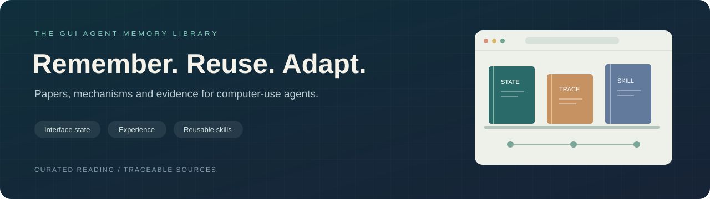

<div align="center">



# Awesome GUI Agent Memory

### GUI 智能体记忆文献库

围绕 GUI／Computer-Use Agent 记忆的精选论文、机制导读与可追溯证据。

[English](README.md) · **简体中文**

[阅读起点](#start) · [主题书架](#shelves) · [完整目录](CATALOGUE.zh-CN.md) · [基准](#benchmarks) · [我们的综述](#survey) · [证据](#evidence)

**论文链接 — 待公开** · **精选书目：43 项** · **分类目录：289 项，截止 2026-09-20**

</div>

---

<a id="start"></a>

## 🧭 阅读起点

| 阅读目标 | 建议路线 |
|---|---|
| 建立整体认识 | [相关综述](#surveys) → [我们的框架](#survey) |
| 比较视觉历史的表示 | [任务状态与视觉历史](#state)：UI-TARS / OpenCUA → PAL-UI → CausalCache → MementoGUI |
| 理解视觉压缩与验证 | [任务状态与视觉历史](#state)：GUI-KV → [维护与安全](#maintenance)：SmartSnap |
| 连接界面知识与操作流程 | [任务状态与视觉历史](#state)：MapAgent → [工作流与技能](#skills)：MobileGPT |
| 连接执行状态与可复用流程 | [任务状态](#state)：ATMem → [工作流与技能](#skills)：AWM → Mobile-Agent-E |
| 理解跨任务经验复用 | [轨迹与经验](#experience)：Synapse → Agent S → [工作流与技能](#skills)：AWM |
| 理解智能体之间的信息共享 | [任务状态与视觉历史](#state)：UFO2 → [我们的框架](#survey)：依赖与作用域 |
| 研究记忆可靠性 | [维护与安全](#maintenance)：HYMEM → Darwinian Memory → VerificAgent |
| 设计评测或核查论断 | [基准与评测](#benchmarks) → [固定证据包](#evidence) |
| 浏览更广泛的文献 | [289 项分类目录](CATALOGUE.zh-CN.md) → [可下载 CSV](catalogue.csv) |

<a id="shelves"></a>

## 📚 主题书架

主题书架提供 43 项精选阅读，包含背景综述。[完整目录](CATALOGUE.zh-CN.md)收录综述选材中截至 **2026-09-20** 的 289 项不同工作：250 项直接记忆研究、39 项相关评测／安全研究。目录按七个主题提供阅读导航，列出保留对象、后续 GUI 用途与原文链接；[CSV](catalogue.csv)另保留采用版本及原文定位。选材依据框架贡献，允许存在覆盖遗漏。

[配套数据](#evidence)提供289项文献目录、逐格赋值、统计汇总、实际检索式及筛选数量汇总。下列导读链接到采用的原文。

[🖥️ 任务状态与视觉历史](#state) · [🧭 轨迹与经验](#experience) · [🛠️ 工作流与技能](#skills) · [👤 用户偏好与任务信息](#personalization) · [🔄 记忆维护与安全](#maintenance) · [🧪 基准与评测](#benchmarks) · [📖 相关综述](#surveys)

<a id="state"></a>

### 🖥️ 任务状态与视觉历史

保留后续操作需要的信息。

**ATMem** · 2026<br>
[What Memory Do GUI Agents Really Need? From Passive Records to Active Task-Driving States](https://arxiv.org/abs/2606.31612v2)<br>
将任务数据组织为执行状态，区分数据适用性、工作流进度与剩余操作。<br>

**PAL-UI** · 2025<br>
[PAL-UI: Planning with Active Look-back for Vision-Based GUI Agents](https://arxiv.org/abs/2510.00413v2)<br>
需要回看时，按历史步骤索引取回截图。<br>

**Chain-of-Memory** · 2025<br>
[Chain-of-Memory: Enhancing GUI Agents for Cross-Application Navigation](https://arxiv.org/abs/2506.18158v1)<br>
用有容量上限的短期记忆保留近期动作结果，并筛选屏幕中的任务相关信息写入长期记忆。<br>

**MementoGUI** · 2026<br>
[MementoGUI: Learning Agentic Multimodal Memory Control for Long-Horizon GUI Agents](https://arxiv.org/abs/2605.18652v1)<br>
将筛选后的事件保存为文字摘要与图像区域，供后续动作判断使用。<br>

**CausalCache** · 2026<br>
[CausalCache: Conditional High-Fidelity Restoration for Long-Horizon GUI Agents](https://arxiv.org/abs/2608.22577v2)<br>
在固定活动图像预算内，将选中的已总结历史事件恢复为图文形式。<br>

**Mem-W** · 2026<br>
[Mem-W: Latent Memory-Native GUI Agents](https://arxiv.org/abs/2605.09317v1)<br>
将历史经验及即将移出的上下文前缀压缩为潜在记忆块，供冻结的 GUI 策略使用。<br>

**UI-TARS** · 2025<br>
[UI-TARS: Pioneering Automated GUI Interaction with Native Agents](https://arxiv.org/abs/2501.12326v1)<br>
将近期截图窗口与完整动作、思考历史一同保留，作为后续决策的输入。<br>

**OpenCUA** · 2025<br>
[OpenCUA: Open Foundations for Computer-Use Agents](https://arxiv.org/abs/2508.09123v1)<br>
用简洁的动作级文本与多张截图表示历史，并在评测中比较历史表示。<br>

**UFO2** · 2025<br>
[UFO2: The Desktop AgentOS](https://arxiv.org/abs/2504.14603v1)<br>
在 GUI/API 混合框架中结合智能体私有状态与共享黑板，保留中间结果及执行信息。<br>

**GUI-KV** · 2025<br>
[GUI-KV: Efficient GUI Agents via KV Cache with Spatio-Temporal Awareness](https://arxiv.org/html/2510.00536v1)<br>
为后续 GUI 动作保留历史视觉 token 的 KV 状态，并依据空间显著性与时间冗余线索裁剪缓存。<br>
[原文：§§3.2–3.3，式 (8)–(9)](https://arxiv.org/html/2510.00536v1)

**GUI-Rise** · 2025<br>
[GUI-Rise: Structured Reasoning and History Summarization for GUI Navigation](https://arxiv.org/abs/2510.27210v1)<br>
根据当前截图与先前摘要更新简洁的历史摘要，结合结构化推理指导后续 GUI 动作。<br>
[原文：§§3.2–3.3，第 4–5 页](https://arxiv.org/abs/2510.27210v1)

**MapAgent** · 2025<br>
[MapAgent: Trajectory-Constructed Memory-Augmented Planning for Mobile Task Automation](https://arxiv.org/abs/2507.21953v1)<br>
从探索轨迹构建页面记忆，检索与任务相关的页面以指导移动端规划与执行。<br>
[原文：Method，Trajectory-based Memory Mechanism 与 Memory-Augmented Task Planning](https://arxiv.org/abs/2507.21953v1)

[↑ 返回书架](#shelves)

<a id="experience"></a>

### 🧭 轨迹与经验

从以往交互中提取可复用的指导。

**Synapse** · 2023<br>
[Synapse: Trajectory-as-Exemplar Prompting with Memory for Computer Control](https://arxiv.org/abs/2306.07863v3)<br>
按任务元数据检索示例轨迹；其 Mind2Web 示例库使用训练集。<br>
[代码](https://github.com/ltzheng/Synapse)

**Agent S** · 2024<br>
[Agent S: An Open Agentic Framework that Uses Computers Like a Human](https://arxiv.org/abs/2410.08164v1)<br>
检索成功子任务经验，并在完成后写回策略摘要。<br>
[代码](https://github.com/simular-ai/Agent-S)

**ReasoningBank** · 2025<br>
[ReasoningBank: Scaling Agent Self-Evolving with Reasoning Memory](https://arxiv.org/abs/2509.25140v2)<br>
保存从成功和失败经历中提取的结构化经验。<br>

**WebCoach** · 2025<br>
[WebCoach: Self-Evolving Web Agents with Cross-Session Memory Guidance](https://arxiv.org/abs/2511.12997v2)<br>
任务结束后保存完整轨迹摘要，执行中依据部分轨迹检索经验。<br>

[↑ 返回书架](#shelves)

<a id="skills"></a>

### 🛠️ 工作流与技能

将交互历史转化为可复用的操作流程。

**Agent Workflow Memory** · 2024<br>
[Agent Workflow Memory](https://arxiv.org/abs/2409.07429v1)<br>
从经历中归纳子任务流程，将实例值抽象为参数，辅助动作生成。<br>
[代码](https://github.com/zorazrw/agent-workflow-memory)

**ActionEngine** · 2026<br>
[ActionEngine: From Reactive to Programmatic GUI Agents via State Machine Memory](https://arxiv.org/abs/2602.20502v1)<br>
记录界面状态转移，为动态内容保留基于选择器的访问模式。<br>

**State-Grounded Dynamic Retrieval** · 2026<br>
[Online Skill Learning for Web Agents via State-Grounded Dynamic Retrieval](https://arxiv.org/abs/2606.04391v1)<br>
从轨迹窗口提取局部技能，通过替换动作片段并重执行进行验证。<br>

**AppAgent** · 2023<br>
[AppAgent: Multimodal Agents as Smartphone Users](https://arxiv.org/abs/2312.13771v3)<br>
在探索中建立并更新界面元素文档，部署时提供当前页面的功能说明。<br>
[代码](https://github.com/TencentQQGYLab/AppAgent)

**Mobile-Agent-E** · 2025<br>
[Mobile-Agent-E: Self-Evolving Mobile Assistant for Complex Tasks](https://arxiv.org/abs/2501.11733v2)<br>
对计划、进度及动作／错误历史进行反思，形成用于后续规划与操作的 Tips 和可执行 Shortcuts。<br>

**MobileGPT** · 2023 预印本／2024 MobiCom<br>
[MobileGPT: Augmenting LLM with Human-like App Memory for Mobile Task Automation](https://arxiv.org/html/2312.03003v3)<br>
在应用记忆图中保存页面与可复用子任务流程，召回动作并适配当前参数与界面。<br>
[原文：§§2.1、4.1–4.2、5.1–5.2](https://arxiv.org/html/2312.03003v3) · [正式发表版本](https://doi.org/10.1145/3636534.3690682)

[↑ 返回书架](#shelves)

<a id="personalization"></a>

### 👤 用户偏好与任务信息

在明确的适用范围内复用用户上下文。

**PersonaTrail / PACMEM** · 2026<br>
[PersonaTrail: Benchmarking Personalized Web Agents through Browsing Trails](https://arxiv.org/abs/2607.20482v2)<br>
将浏览历史分为事实记忆与偏好记忆，结合语义和时间线索检索。<br>

**PersonalAlign / HIM-Agent** · 2026<br>
[PersonalAlign: Hierarchical Implicit Intent Alignment for Personalized GUI Agent with Long-Term User-Centric Records](https://arxiv.org/abs/2601.09636v2)<br>
将 GUI 用户记录聚合为原型，每日更新层级化的偏好与例行意图记忆。<br>

**MemAgent** · 2025<br>
[MemAgent: A cache-inspired framework for augmenting conversational Web Agents with task-specific information](https://ceur-ws.org/Vol-4028/paper8.pdf)<br>
将任务信息收集与执行分开，并为缓存的任务实体设置过期策略。<br>

[↑ 返回书架](#shelves)

<a id="maintenance"></a>

### 🔄 记忆维护与安全

更新有效记忆，并处理过时或有害内容。

**HYMEM** · 2026<br>
[Hybrid Self-evolving Structured Memory for GUI Agents](https://arxiv.org/abs/2603.10291v1)<br>
检索相邻经验节点并检查冗余后，选择新增、合并或替换。<br>

**Darwinian Memory** · 2026<br>
[Darwinian Memory: A Training-Free Self-Regulating Memory System for GUI Agent Evolution](https://arxiv.org/abs/2601.22528v1)<br>
结合使用效用、时间衰减和执行验证失败惩罚，调节记忆存留与剪枝。<br>

**PANDO** · 2026<br>
[PANDO: Efficient Multimodal AI Agents via Online Skill Distillation](https://arxiv.org/abs/2605.24785v2)<br>
通过关键词检索规则与程序技能，并对反复失败的技能进行持久降级。<br>

**VerificAgent** · 2025<br>
[VerificAgent: Domain-Specific Memory Verification for Scalable Oversight of Aligned Computer-Use Agents](https://arxiv.org/abs/2506.02539v3)<br>
使用经专家核查的轨迹教训，测试推理时保持记忆冻结。<br>

**SmartSnap** · 2025<br>
[SmartSnap: Proactive Evidence Seeking for Self-Verifying Agents](https://arxiv.org/html/2512.22322v1)<br>
收集任务完成证据截图并检查其有效性，支持移动端任务自验证。<br>
[原文：§§3.2–3.4，Evidence Validity Check，式 (3)](https://arxiv.org/html/2512.22322v1)

**环境注入式记忆投毒** · 2026<br>
[Poison Once, Exploit Forever: Environment-Injected Memory Poisoning Attacks on Web Agents](https://arxiv.org/abs/2604.02623v2)<br>
研究网页内容如何污染保存的轨迹，并通过记忆召回影响后续任务。<br>

[↑ 返回书架](#shelves)

<a id="benchmarks"></a>

### 🧪 基准与评测

结合交互协议理解报告的指标。

**MemGUI-Bench · GUI 在线执行** · 2026<br>
[MemGUI-Bench: Benchmarking Memory of Mobile GUI Agents in Dynamic Environments](https://arxiv.org/abs/2602.06075v3)<br>
在 Android GUI 在线执行中评测失败后重置与镜像任务对之间的经验迁移。<br>

**AndroTMem · 预录轨迹** · 2026<br>
[AndroTMem: From Interaction Trajectories to Anchored Memory in Long-Horizon GUI Agents](https://arxiv.org/abs/2603.18429v1)<br>
在预录轨迹的固定截图和标注动作上，评测状态锚点及依赖关系。<br>

**LongMemEval-V2 · 记忆问答** · 2026<br>
[LongMemEval-V2: Evaluating Long-Term Agent Memory Toward Experienced Colleagues](https://arxiv.org/abs/2605.12493v1)<br>
按序插入轨迹，再以答案准确率和查询延迟评测固定 reader。<br>

**MemGym · 长程环境** · 2026<br>
[MemGym: a Long-Horizon Memory Environment for LLM Agents](https://arxiv.org/abs/2605.20833v1)<br>
使用相同 reasoner 衡量记忆收益，同时考虑记忆会改变后续动作分布。<br>

**Web 智能体预算约束研究** · 2026<br>
[Are Online Skill and Memory Modules Always Worth Their Tokens? A Budget-Constrained Study of Web Agents](https://arxiv.org/abs/2606.15017v2)<br>
将动作生成、流程归纳、技能合成、记忆构建、检索及验证调用计入每任务 token 成本。<br>

[↑ 返回书架](#shelves)

<a id="surveys"></a>

### 📖 相关综述

用于理解 GUI 记忆研究背景的更广泛视角。

**LLM 智能体记忆机制** · 2024<br>
[A Survey on the Memory Mechanism of Large Language Model based Agents](https://arxiv.org/abs/2404.13501v1)<br>
按定义、来源、形式、操作及评测组织的通用记忆导读。<br>

**Memory in the Age of AI Agents** · 2025<br>
[Memory in the Age of AI Agents](https://arxiv.org/abs/2512.13564v2)<br>
通过形式、功能和动态过程组织智能体记忆。<br>

**LLM-Brained GUI Agents** · 2024<br>
[Large Language Model-Brained GUI Agents: A Survey](https://arxiv.org/abs/2411.18279v12)<br>
梳理 GUI 智能体的组件、框架、数据、模型、评测与应用。<br>

**OS Agents** · 2025<br>
[OS Agents: A Survey on MLLM-based Agents for General Computing Devices Use](https://arxiv.org/abs/2508.04482v1)<br>
将记忆置于 OS 智能体架构中，专门讨论记忆来源、管理与检索。<br>

**Efficient GUI Agents** · 2026<br>
[Efficient GUI Agents: A Systems Survey of Observation, Memory, Action, and Runtime Optimization](https://arxiv.org/abs/2609.02309v1)<br>
从系统效率角度考察摘要压缩、选择性回看与运行时表示压缩。<br>

**长时记忆安全** · 2026<br>
[A Survey on Long-Term Memory Security in LLM Agents: Attacks, Defenses, and Governance Across the Memory Lifecycle](https://arxiv.org/abs/2604.16548v2)<br>
沿记忆生命周期组织攻击、防御与治理，包含 eTAMP 和 VerificAgent。<br>

**智能体技能的系统基础** · 2026<br>
[Towards a Systems Foundation for Agentic Skills: Architecture, Lifecycle, and Security](https://arxiv.org/abs/2608.29596v1)<br>
连接技能发现、表示、存储、路由、执行／修复与治理，包含 GUI/OS 导航场景。<br>

[↑ 返回书架](#shelves)

<a id="survey"></a>

## 📘 我们的综述

**The State of Memory in GUI Agents: A Lifecycle-Centric Survey**

**GUI 智能体记忆研究现状：以生命周期为中心的综述**

**论文链接 — 待公开。** 公开后将在此提供论文链接与正式引用信息。

综述考察操作 Web、桌面和移动界面的语言模型与视觉语言模型智能体中的记忆。**生命周期—状态框架**将视觉证据、界面知识、任务状态与轨迹、可复用技能、用户与会话情境五类保留对象，与写入、表示、检索、使用、验证／恢复及更新／遗忘六种操作联系起来。对象类别描述记录所涉及的内容；文本、图和潜在表示描述存储形式。

当前综合以 [289 项分类文献](CATALOGUE.zh-CN.md)为基础，逐项按原文核对保留对象及后续 GUI 用途。框架将维护操作与其作用对象、评测终点联系起来；映射反映原文支持的机制，效果比较与领域分布仍需相应的评测条件和抽样依据。

生命周期操作构成机制比较的主轴，五类对象用于区分同一操作作用于什么信息，以及相应的有效条件：

| 状态层级 | 保留内容 | 使用与维护的关键条件 |
|---|---|---|
| **L1 视觉证据** | 截图、区域与视觉描述 | 观测的时间、位置及其对当前判断的适用性 |
| **L2 界面知识** | 元素功能与界面转移 | 当前界面中的功能与绑定是否仍然有效 |
| **L3 任务状态与轨迹** | 动作、已确认效果与待办项 | 区分已完成、待执行和仍待确认的工作 |
| **L4 可复用技能** | 参数化操作流程 | 前置条件、参数绑定与执行环境是否匹配 |
| **L5 用户与会话情境** | 用户信息、偏好与账户情境 | 授权、用户／账户作用域及撤回条件 |

六种操作分别负责信息准入、形式组织、内容选择、决策使用、问题检测与恢复、内容或可用性的修订。组件可以组合多种操作，执行过程也可反复经过同一操作。五类对象与目录中的七个阅读主题用途不同；复合记录可涉及多个对象。

机制比较围绕三组设计权衡展开：

| 设计权衡 | 阅读重点 |
|---|---|
| **保真与抽象** | 压缩或摘要保留了哪些细节，后续决策需要时还能恢复哪些信息？ |
| **复用与适用性** | 流程的哪些部分可以迁移，哪些变量绑定或条件需要在当前界面重新检查？ |
| **持久化与纠正** | 记录改变后，哪些派生知识与活跃上下文也需要改变，才能使后续动作反映纠正？ |

区分**流程、变量绑定与适用条件**，有助于定位需要修复的对象，同时保留有用知识。跨层依赖将观测连接到任务事实、轨迹连接到技能、用户信息连接到后续计划。因此，存储中的记录与智能体当前消费的上下文可能需要不同的更新。

评测沿保留信息到动作的路径展开：**回忆、记录观测上的动作选择与在线执行**衡量不同终点。比较同时考虑经验、重置条件与资源预算；安全分析进一步保留攻击者权限及保留内容影响后续行为的路径。研究议程提出**任务续接与跨层纠正测试**，用于测量修订能否到达后续决策，以及未受影响的有用知识能否继续保留。

### 挑战与未来方向

综述从已有机制及其适用条件提出六项研究方向：

- **记忆质量与有效使用**：联合改进准入、压缩、检索及决策使用，在匹配的经验与预算下测量任务收益。
- **具有有效条件的抽象**：将紧凑流程与适用条件、可恢复的原始证据联系起来。
- **不完整反馈下的任务连续性**：区分预期动作、已观测效果与待确认状态，评测中断后的续接。
- **跨层纠正**：识别依赖并传播修订，同时保留未受影响知识的效用。
- **随时间累积的经验与计算成本**：联合计入初始构建、重复使用、验证及维护成本。
- **具有作用域的互操作接口**：在组件替换或共享时保留对象身份、来源、适用条件与纠正依赖。

<a id="evidence"></a>

## 🔎 证据与可复现性

版本 **`evidence-20261014-v2`** 提供《GUI 智能体记忆研究现状：以生命周期为中心的综述》的配套数据，文献截止日期为 **2026-09-20**。

| 内容 | 范围与数量 |
|---|---|
| 文献目录 | **289 项工作**：250 项直接记忆研究、39 项评测或安全研究，含分类、中英文描述、采用版本及原文定位 |
| 对象—操作矩阵 | **246 项机制研究**的 **1,119 项工作—单元格赋值** |
| 文献统计 | 按公开年份、主题、类别、分析角色及矩阵单元格汇总的计数 |
| 检索与筛选 | **五个数据库的 13 组查询**、执行日期、命中数及筛选数量汇总 |
| 说明与校验 | 中英文 README、字段说明、CC BY 4.0 许可证、文件哈希及离线校验脚本 |

- [下载数据包](https://github.com/kqcoxn/Awesome-GUI-Agent-Memory/releases/download/evidence-20261014-v2/evidence-20261014-v2.zip) · [数据包说明](https://github.com/kqcoxn/Awesome-GUI-Agent-Memory/blob/evidence-20261014-v2/releases/evidence-20261014-v2/README.zh-CN.md) · [Zenodo](https://doi.org/10.5281/zenodo.23366556)
- [文献目录](https://github.com/kqcoxn/Awesome-GUI-Agent-Memory/blob/evidence-20261014-v2/releases/evidence-20261014-v2/catalogue.csv) · [矩阵赋值](https://github.com/kqcoxn/Awesome-GUI-Agent-Memory/blob/evidence-20261014-v2/releases/evidence-20261014-v2/matrix_assignments.csv)
- [统计汇总](https://github.com/kqcoxn/Awesome-GUI-Agent-Memory/blob/evidence-20261014-v2/releases/evidence-20261014-v2/corpus_counts.json) · [检索记录](https://github.com/kqcoxn/Awesome-GUI-Agent-Memory/blob/evidence-20261014-v2/releases/evidence-20261014-v2/search_runs.csv) · [筛选数量](https://github.com/kqcoxn/Awesome-GUI-Agent-Memory/blob/evidence-20261014-v2/releases/evidence-20261014-v2/selection_summary.json)
- [字段说明](https://github.com/kqcoxn/Awesome-GUI-Agent-Memory/blob/evidence-20261014-v2/releases/evidence-20261014-v2/data_dictionary.md) · [许可证](https://github.com/kqcoxn/Awesome-GUI-Agent-Memory/blob/evidence-20261014-v2/releases/evidence-20261014-v2/LICENSE.md) · [文件哈希](https://github.com/kqcoxn/Awesome-GUI-Agent-Memory/blob/evidence-20261014-v2/releases/evidence-20261014-v2/manifest.sha256)

使用 Python 3.9 或更高版本校验文件、记录关联和计数：

```sh
cd releases/evidence-20261014-v2
python3 validate.py
```

## 🤝 参与贡献

欢迎通过 [Issue](https://github.com/kqcoxn/Awesome-GUI-Agent-Memory/issues) 或 Pull Request 推荐论文、修正链接或改进导读。请提供原始论文链接、建议分类及一两句话说明与 GUI 记忆的关系；代码链接应指向作者发布的实现。修改条目时同步更新中英文版本。涉及数据修正时，请附工作标识与原文定位。

## 🌐 延伸阅读

- [GUI Agents Paper List](https://github.com/OSU-NLP-Group/GUI-Agents-Paper-List)
- [LLM-Brained GUI Agents Survey](https://github.com/vyokky/LLM-Brained-GUI-Agents-Survey)
- [From Storage to Experience](https://github.com/FeishuLuo/Evolving-LLM-Agent-Memory-Survey)

---

<div align="center">

[English](README.md) · **简体中文**

从文献发现到证据核查。

</div>
